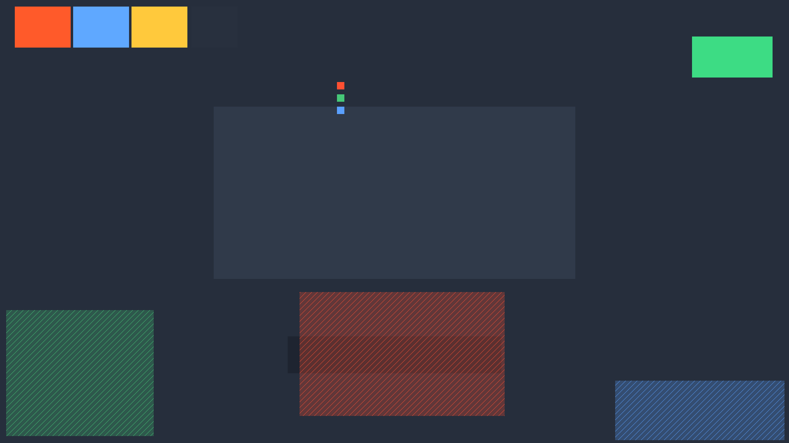
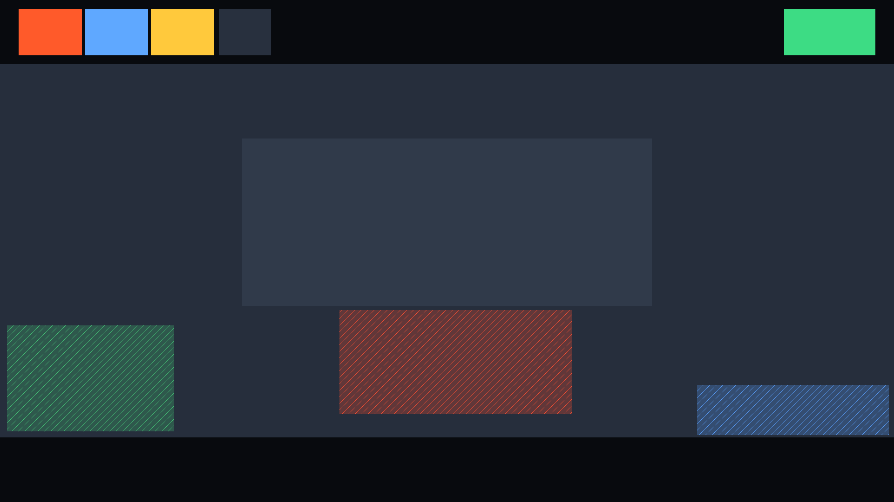

# Protocol HUD

Live Kills / Deaths / Wins overlay for Streamlabs that counts itself while you play Wardogs. It has streak callouts, a K.I.A. glitch, a victory screen, and sound effects.

## Running
- The server starts automatically when you log in (Startup folder shortcut "Protocol HUD"). To start it by hand, double-click `start-hud.cmd`.
- Control panel: http://127.0.0.1:8790/control
- Log: `hud.log`

## In Streamlabs
The source **"Protocol HUD"** sits at the top of **Live Scene** with URL `http://127.0.0.1:8790/overlay?pos=bar`, so the tiles sit in the black letterbox strip above the game.
Its audio goes to the stream only (it appears in the mixer as "Protocol HUD"). To hear it yourself, open Advanced Audio Properties and set monitoring to "Monitor and Output".

URL options (combine with `&`):
- `pos=bar|tl|tr|bl|br`: layout (default `tl`; Streamlabs uses `bar`)
- `scale=0.8`: size
- `vol=0.5`: volume; `mute=1` turns sound off
- `hud=0`: animations only
- `big=0`: no full-screen callouts

## Setup for your monitor

The overlay canvas is always 1920×1080. HUD tiles and the OCR kill-feed crops are anchored to a **game rect** on that canvas, picked on the control page (saved in `config.json`, also in `/api/state`).

| Preset | Use it when | Game rect on the 1920×1080 canvas |
|---|---|---|
| **16:9** (default for new users) | The game fills the frame — a normal monitor, no letterbox | `0, 0, 1920, 1080` |
| **ultrawide-letterbox** | 21:9 / 32:9 game in a 16:9 stream, black bars top and bottom (SwampBewdy's layout) | `0, 138, 1920, 803` — **pixel-identical to the original HUD** |
| **custom** | Anything else | You set `x, y, w, h` |

Existing installs that already have a `config.json` without this setting keep **ultrawide-letterbox**, so Adam's stream does not move.

<p align="center">
  
  <br><sub><b>16:9.</b> Solid tiles are the Protocol HUD (K/D/W top-left, STREAM PROFIT top-right under the in-game cash). Hatched zones are Wardogs' kill feed, minimap and ammo/health — the overlay does not cover them.</sub>
</p>

<p align="center">
  
  <br><sub><b>Ultrawide letterbox.</b> Same HUD as before: tiles sit in the top black bar, STREAM PROFIT in the top-right of that bar. The game (and its own HUD) is the middle band.</sub>
</p>

Pick the preset on http://127.0.0.1:8790/control → **Display layout**. No Streamlabs change needed; the overlay and the auto-detect crops update live.

## Auto-detect (Wardogs)
While `WardogsClient-Win64-Shipping.exe` is the focused window, the server reads the screen about 4× per second with the built-in Windows OCR. It only reads pixels. It never touches game files or memory, and nothing leaves your PC.

| Event | What it looks for |
|---|---|
| Kill | each "KILL CONFIRMED" line stacked under the crosshair |
| Death | only a real death: the "RESPAWNING IN..." countdown. Getting downed shows a small DOWNED note, and a revive shows REVIVED. Neither counts |
| Win | the end-of-match scoreboard headed **VICTORY**. DEFEAT and the "<TEAM> WINS" splash are ignored |

Pause or resume it from the control panel, or set `auto_detect` to false in `config.json`. Switch games from **Game** on the control page (`hud/games/<id>.json`); it applies live, no restart. See [CONTRIBUTING.md](../CONTRIBUTING.md#add-a-game) to add a profile.

## STREAM PROFIT
`cash_delta = (cash_now - cash_start) + cash_invested`.

When the detector also reads the game's per-life money counter (the number left of the balance), unlocks are split from kits using that counter: kits and earnings move the counter and the balance together; unlocks move only the balance. If the counter is missing, the fallback is: a drop ≥ $5K that is a menu reading or a round amount is invested, and a large round drop (≥ $20K) is an unlock even on the deploy screen after a death. Odd kit amounts stay in `cash_kits`.

Manual override: control-panel **Mark last drop invested** / hotkey Ctrl+Alt+5. Undo invest: Ctrl+Alt+6. APIs: `/api/cash/invest`, `/api/cash/invest/undo`.

## Manual overrides
Hotkeys that work in-game: Ctrl+Alt+1 kill · Ctrl+Alt+2 death · Ctrl+Alt+3 win · Ctrl+Alt+4 undo · Ctrl+Alt+5 mark last drop invested · Ctrl+Alt+6 undo invest · Ctrl+Alt+0 twice = reset.
Companion / Stream Deck: HTTP GET `http://127.0.0.1:8790/api/kill` (also `death`, `win`, `undo`, `reset`, `invest`, `session/start`).
Test animations without changing counts: `/api/test/kill?n=5`, `/api/test/death`, `/api/test/win`.

## New stream = zero
Idle auto-reset is **off** by default (`new_session_after_hours: 0`). Hit **Start session** on the control panel (or `/api/session/start`) at go-live so the baseline is intentional and unlocks stay invested. Hold RESET to zero counters by hand.

## Watchdog

`watchdog.py` polls `http://127.0.0.1:8790/health` and restarts the HUD in the same Windows session if it is down or stale (capture stuck). It will not restart a healthy idle HUD (game unfocused is not stale). Install the hidden logon tasks from this folder:

```powershell
powershell -NoProfile -ExecutionPolicy Bypass -File .\install_watchdog.ps1
```

The scripts use the HUD folder they live in and `pythonw` from `PATH` (or `PROTOCOL_HUD_PYTHON`). Optional: set `STREAM_KEEPER_DIR` if you also run Stream Keeper and want auto-saved server IDs.

## Tests
`python test_stream_profit.py` — unit tests for invest/kit classification, the per-life counter split, and a calibrated 2026-10-28 replay (~+$43K stream profit vs deeply-negative raw delta).

`python test_capture_recovery.py` — unit tests for stale-frame / DXGI access-lost capture recovery used by `/health`.

## Sound design
Built-in sounds are short and restrained: a soft thump and click per kill, a low cinematic hit on 5/8/12/20 streaks, a muffled hit on death, and a warm chord swell on VICTORY. Default volume is 0.55. Streak callouts are LETHAL (5), RELENTLESS (8), UNTOUCHABLE (12), and APEX (20). Doubles only show in the feed. Triples and up get a callout.

## Sound packs
Rendered 48 kHz stereo packs live in sounds/<pack>/ (built by 	ools/gen_sounds.py): **tactical** (default: tight hit-marker tick and thud, metallic ring on streaks, muffled death with a faint ear-ring, warm chord on victory, heartbeat when downed) and **cinematic** (deeper punches, a low 'braam' on streaks, big reverb tails). Switch packs or audition them on the control panel. The change applies to the stream instantly. **synth** uses the old built-in sounds.

## Custom sounds
Make a folder `sounds/<yourpack>/` containing any of `kill`, `double`, `triple`, `multi`, `spree`, `death`, `win`, `downed`, or `revived` (.wav/.mp3/.ogg). It appears as a pack on the control panel.

## Tools
- `tools/analyze_clips.py`: accuracy test against Discord clips
- `tools/analyze_segment.py`: test against a slice of a stream recording
- `tools/add_to_streamlabs.py`: re-adds the source (close Streamlabs first; it backs up first)

## Game Boost
While Wardogs runs, the game and Streamlabs (obs64) get above-normal priority. Background apps (G HUB Replay/Highlighter, Streamlabs AI vision, Syncthing, Steam web helper, SteelSeries GG/Prism, Logitech LCore/G HUB, password managers, NordVPN UI, OneDrive, Teams, Word, Brave, Docker, and similar) are pinned to the 4 E-cores at below-normal priority with Windows EcoQoS. Everything is restored when the game closes. Audio (Voicemeeter, SteelSeries Sonar), Discord, TikTok LIVE Studio and Companion are never touched. Check it at /api/boost; turn it off with game_boost: false in config.json.

## Performance log
While Wardogs is focused, 	ools/perf.csv records GPU load/clock/encoder, total CPU, and CPU for Wardogs, Streamlabs, TikTok LIVE Studio and Discord every 2 s.
